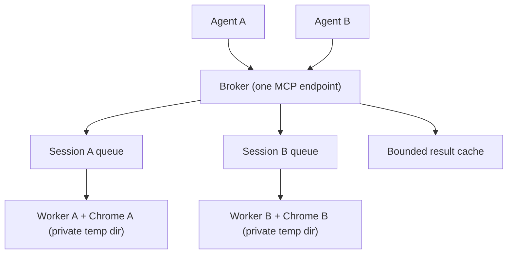

# Architecture

This document explains why the broker is built the way it is. The [README](../README.md) covers usage; [VALIDATION.md](VALIDATION.md) records measurements.

## Goal

Let cooperative local agents use Chrome DevTools at the same time without sharing a selected tab, a browser profile, or an upstream tool-call queue, and keep what each call returns small.

The broker talks to the published `chrome-devtools-mcp` only through MCP. It does not reimplement browser automation or import upstream internals, so upgrading upstream means changing one pinned version. The pin is exact, not a range, because the flag denylist below is written against that version's flags; a new upstream flag could open a hole the denylist does not know about.

The two session queues run independently. The result cache only stores finished results; it is not an execution lock.

## Why one worker per session

Upstream can already serve several agents from one worker. Named isolated browser contexts keep their cookies apart, and with page-ID routing, a call to a page tool that names a `pageId` runs on that page's own queue, so page tools on different pages overlap. That is the memory-efficient option, and for agents that mostly navigate, click and fill it is enough. It does not make agents independent: every other call, including the tools upstream marks as browser-wide, such as script evaluation, page management and performance traces, runs on a browser-wide queue that waits for every page queue and blocks them all while it runs. One agent's long script or trace therefore stalls every other agent (measured in [VALIDATION.md](VALIDATION.md#parallelism)). Each tool's category is the `concurrency` field of its upstream definition; see `#queueFor` in upstream's [ToolHandler](https://github.com/ChromeDevTools/chrome-devtools-mcp/blob/main/src/ToolHandler.ts). Sharing one worker safely would also mean tracking which agent owns which context and page, and handling browser-wide operations and cleanup, against upstream internals that can change.

So each session gets its own upstream subprocess and its own Chrome. This costs RAM and a Chrome launch per session, and buys process-level independence for every tool: a long action for agent A never occupies agent B's worker or queue. CPU and memory are still shared, so heavy sessions can slow each other down.

`workerFlags()` in [src/upstream.js](../src/upstream.js) is the source of truth for what every worker gets. The reasons:

- `--isolated` gives each Chrome a temporary profile, so sessions never contend for or share the default user-data directory.
- Usage statistics, CrUX lookups, update checks, and config-file discovery are off, so a worker does nothing on its own initiative.
- `file:` navigation is off unless `--allow-file-urls`, because page JavaScript plus `file:` URLs would expose local files.
- Headless unless `--headed`; `--chrome-path` and `--no-sandbox` map to upstream's executable path and Chrome argument.

Flags after `--` are appended verbatim, so users get upstream's full configuration (viewport, workspace, tool categories, proxy, and so on) without the broker copying upstream's option list. The broker rejects only flags that would break the model above: attaching to an existing browser, a shared or explicit profile (including through `--chrome-arg`), unrestricted file paths, a workspace that is or contains the OS temp directory (where every session's private directory lives), a Chrome remote-debugging endpoint (which would skip the token), config files that could set those, and flags the broker owns. The grammar is strict, each token `--name` or `--name=value`, because upstream's parser reads any other token as a value of whichever flag precedes it, a positional, or a cluster of short flags; a strict grammar leaves no token whose meaning the check could misread. Matching follows upstream's parser and Chrome's switch parsing loosely (spelling variants, negations, quotes, switch prefixes), and a Chrome argument matches by switch-name prefix, because puppeteer drops its own temporary profile for any argument that merely starts with `--user-data-dir`; both err towards rejection. `--ignore-default-chrome-arg` stays allowed: puppeteer appends the per-session profile and DevTools pipe after dropping ignored defaults, so it cannot break isolation, though it can turn headless mode off. The list and the reason for each entry live in `deniedFlags` and `deniedChromeSwitches` in the same file. Upstream only warns about a flag it does not know and ignores it, and a bad value would otherwise fail every session open, so before serving, the broker starts one worker with the final flags (MCP handshake and `tools/list`, no Chrome) and stops on any error or unknown-flag warning.

Workers inherit the broker's environment minus every `CHROME_BROKER_*` variable (in any case), so the HTTP token never reaches upstream, Chrome, or page JavaScript. `TMPDIR`, `TMP` and `TEMP` point at a private directory per worker (mode 0700), removed after the worker exits. Upstream file tools may always use the OS temp directory, and the `--isolated` profile is created there; with one shared temp directory, a session could read another session's profile through `upload_file`. The private directory keeps each profile, and every file upstream saves to its temp directory, within its own session and deletes them on close.

## Frontend and session identity

HTTP uses Streamable HTTP in stateless mode: every POST gets a fresh MCP server and transport. Browser sessions are application objects created by `chrome_session`, independent of HTTP connections and MCP session headers, so any client that holds a `sessionId` can keep using it across requests.

The server binds to 127.0.0.1 only, checks `Host` and `Origin` against its own address to defeat DNS rebinding from web pages, and requires a bearer token (`CHROME_BROKER_TOKEN`) unless started with `--no-auth`. Session IDs are 192-bit random values and act as capabilities; a result ID is only valid together with its session ID, and no tool lists sessions. Labels are for logs, not identity.

This is cooperative separation between trusted agents, not tenant-grade authorization: an agent that learns another session's ID can use it.

stdio runs the same broker logic on one connection. A host can route several logical agents through it, but separately launched stdio brokers share nothing: not capacity, sessions, or cached results.

## Admission and ordering

Opening a session reserves a capacity slot before awaiting worker startup, so concurrent opens cannot overshoot `--max-sessions`. A slot stays reserved until the worker is actually gone: a cancelled or timed-out startup that finishes late is closed first, and a teardown that exceeds the cleanup wait returns to the caller while still holding its slot. Slow cleanup therefore never lets more workers run than configured. When all slots are taken, the `CAPACITY` error reports how many are busy, idle, and closing and when the next idle one expires, without revealing other sessions' IDs.

Each session has a promise queue: one active call plus at most `--max-queue` waiting calls. A full queue fails only that session's call.

## Timeouts, cancellation, and retirement

A timed-out MCP request may still be running a browser action. Releasing the queue to the next call could overlap two actions or act on an unknown page state. So an active timeout, an active cancellation, or an upstream disconnect retires the whole session, and its queued calls fail. A call cancelled while still queued simply never runs and leaves the session healthy. The broker never retries an action itself.

The default call deadline sits just below the MCP SDK client's default request timeout (`sessionDefaults` in [src/sessions.js](../src/sessions.js)), so a client with default settings gets the broker's `CALL_TIMEOUT`, which says the session was retired and the outcome may be unknown, rather than its own generic timeout, which says neither. A session can also close between an agent's calls, by idle expiry, retirement or a worker crash, so for a while after closing, its ID still answers `SESSION_NOT_FOUND` with the reason; the agent can then tell an expected expiry from an action whose outcome it must check before retrying. Only the holder of an ID learns why that session closed, and the memory is bounded by `idleTtlMs` and by count.

Because each HTTP POST has its own transport, an MCP `notifications/cancelled` sent in a later POST cannot reach the request it refers to. HTTP callers stop work by closing the session or letting the call deadline expire; a dropped HTTP connection also cancels its request once the server notices. stdio has one transport and propagates normal cancellation.

Idle expiry applies only to sessions with no pending work. A periodic sweep closes expired sessions, so an idle session can keep its memory for up to one sweep interval (`min(idleTtlMs, 30 s)`, set in [src/sessions.js](../src/sessions.js)) past its TTL. Opening a session at capacity does not wait for the sweep: it closes overdue idle sessions first, so the retry time in a `CAPACITY` error holds. All state is in memory; a restart ends every session.

## Tool discovery

Clients see four tool schemas. `chrome_tools` asks the session's worker for `tools/list` and returns either short summaries or one tool's exact definition, so the broker never hard-codes upstream argument schemas and stays correct when upstream or the passthrough flags change the tool set. Upstream semantics stay authoritative: callers carry the latest snapshot's element UIDs, and page tools act on the page upstream has selected (`new_page`, `select_page`); the broker does not track pages or invent identities. Workers run with `--no-page-id-routing`, because a session belongs to one agent and runs its calls in order, so upstream's page-ID routing would only make every page tool require `pageId`; `-- --page-id-routing` restores it. All four broker tools reject unknown top-level keys instead of stripping them, so an upstream argument placed beside `args` fails with a hint rather than being silently dropped.

Opening a session starts its worker; listing tools does not launch Chrome. Chrome launches on the first browser tool call.

## Output processing

Every upstream result is stored as-is before anything is rendered, and the reply is one JSON text block: a slice of the result's text plus `resultId`, `totalChars`, `offset`, `nextOffset`, and `truncated`. Keeping the raw result separate from its view is what makes paging, filtering, and selection safe: reading more never repeats the action, which may have submitted a form or clicked a button. If rendering fails after the action ran (for example, a JSON Pointer that does not exist), the error says `executed: true` and carries the `resultId`, so the caller can fix the view with `chrome_read` instead of replaying the action.

Design choices:

- The budget counts characters of the serialized reply, including JSON escaping and metadata, because that is what the broker can bound exactly. It is not a tokenizer count, and the outer MCP envelope and images are outside it.
- `filter` is a literal, case-insensitive line match with one line of context, and `select` is an RFC 6901 JSON Pointer. Both are deterministic projections; neither runs code or guesses relevance. An offset belongs to one projection: keep `select` and `filter` unchanged while paging.
- Images are opt-in, and at most one is returned per reply. Otherwise image, audio, and binary blobs are replaced by a type-and-size note, because base64 data is the most expensive thing to put in a context window.

### Cache bounds

Cached results are bounded by entry count, total bytes, bytes per result, and an absolute TTL from insertion (reads refresh LRU order, not expiry). The defaults are in the `ResultStore` constructor in [src/results.js](../src/results.js). Byte limits count serialized UTF-8, not process memory. A result over the per-result limit is still returned once, with `stored: false` and `reason: "result_too_large"`, but cannot be paged later. Closing or expiring a session deletes its results. The worker transport separately caps a single upstream message (`maxBufferSize` in [src/upstream.js](../src/upstream.js)); for larger data use upstream pagination or file output.

This is short-lived retrieval state. Callers must check `truncated` and `stored` rather than assume a result can be read again.

## Limits of the concurrency promise

The broker runs different sessions in parallel, but only if the client sends their calls concurrently; a client that serializes all tool calls, or gives one MCP connection to one agent at a time, is a bottleneck the broker cannot remove. Two agents sharing one session share one browser and one queue by design. Two sessions never share cookies or logins; coordinate shared accounts at the application level.

## References

- [Chrome DevTools MCP configuration](https://github.com/ChromeDevTools/chrome-devtools-mcp/blob/main/docs/configuration.md) and [tool reference](https://github.com/ChromeDevTools/chrome-devtools-mcp/blob/main/docs/tool-reference.md)
- [Concurrent sessions](https://github.com/ChromeDevTools/chrome-devtools-mcp/blob/main/docs/advanced-usage.md), [ToolHandler queue choice](https://github.com/ChromeDevTools/chrome-devtools-mcp/blob/main/src/ToolHandler.ts) and [TaskRunner queue rules](https://github.com/ChromeDevTools/chrome-devtools-mcp/blob/main/src/utils/TaskRunner.ts)
- [MCP Streamable HTTP](https://modelcontextprotocol.io/specification/2025-06-18/basic/transports)
- [RFC 6901: JSON Pointer](https://www.rfc-editor.org/rfc/rfc6901)
